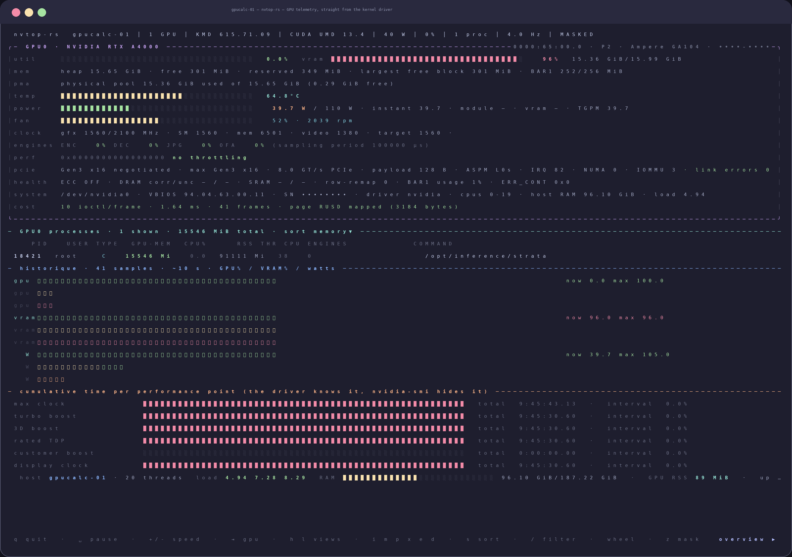

# nvtop-rs



**A GPU monitor that never asks NVIDIA's permission.** `nvtop-rs` reads
temperature, wattage, clocks, throttling, memory pools, PCIe error counters and
per-process GPU memory **directly from the kernel driver** — `ioctl()`s on
`/dev/nvidia*`, the driver's shared telemetry page, and `procfs`/`sysfs`.

No `libnvidia-ml`. No `nvidia-smi` in the hot path. No CUDA toolkit. No crates:
one `.rs` tree, one `rustc` invocation, ~700 KB.

```console
$ ldd target/release/nvtop-rs
        libgcc_s.so.1 => /lib/x86_64-linux-gnu/libgcc_s.so.1
        libc.so.6 => /lib/x86_64-linux-gnu/libc.so.6      # that's the whole list
$ strace -f -e trace=openat ./target/release/nvtop-rs --once >/dev/null
openat(AT_FDCWD, "/dev/nvidiactl", O_RDWR)             = 3
openat(AT_FDCWD, "/dev/nvidia0",   O_RDWR)             = 4
openat(AT_FDCWD, "/proc/driver/nvidia/gpus/0000:65:00.0/information", O_RDONLY) = 5
# zero hits for libnvidia-ml, zero hits for nvidia-smi, zero hits for libcuda
```

## Why

`nvidia-smi` is a fine tool and a terrible dependency. Monitoring pipelines that
fork it once per scrape pay a process spawn, a full control round-trip and a
text table to re-parse, and break the moment the layout or driver changes — and
in a container that only bind-mounted `/dev/nvidia*`, the binary is not even
there. Meanwhile every number already lives in the kernel driver; it is simply
not in `sysfs`.

This project's sibling,
[**nvidia-smi, without nvidia-smi**](https://github.com/zagg/nvidia-smi-clone-RE),
documents how that interface was recovered byte by byte. `nvtop-rs` is its Rust
child, aimed at *watching* rather than *reporting*: 2 Hz by default, ~1 ms per
sample, one telemetry `ioctl` per GPU per frame.

## What you get that `nvidia-smi` does not show

| | Where it comes from |
|---|---|
| **Cumulative time spent throttled, per performance point** — not a sampled boolean | RUSD `clkThrottleInfo.violation[]` (the driver counts in ns; the bar shows % of the last interval *and* total since boot) |
| **Per-engine, per-PID occupancy** (FB / GR / NVENC / NVDEC / NVJPG / NVOFA) | RUSD `procUtil` ring, 5 samples with timestamps |
| **Fan RPM**, not just duty % | RUSD `fanCoolerStatus.rpmCurr[16]` |
| **8 PCIe link error counters** — line-code, CRC, NAKs, failed L0S exits, correctable, non-fatal, fatal, unsupported requests | RUSD `pciBusData[]`, plus the kernel's `aer_dev_*` |
| **PMA**: the driver's physical memory pool, total and free | RUSD `pmaMemoryInfo` |
| **BAR1** accounting, module / VRAM / CPU power rails, **TGPM** | RUSD `bar1MemoryInfo`, `avgPowerUsage`, `instPowerUsage`, `powerPolicyStatus` |
| **ECC detail**: volatile + aggregate, TOTAL/DRAM/SRAM, unique counts, L2/SM/PCIe/firmware buckets, last-cleared timestamp | RUSD `memEcc`, mirrored by `0x20803400` / `0x20803401` |
| **Board EEPROM**: serial, product part, 699-/965-part numbers, memory part, date code, vendor, board revision | `0x2080013f` |
| **Cost of monitoring itself**: ioctl/frame, ms/sample | measured live in the panel footer |

And everything you expect from a GPU monitor: utilisation, VRAM used/free/
reserved, five temperature sensors, power vs limit, clocks per domain, P-state,
throttle reasons decoded, PCIe gen/width, NUMA affinity and CPU list, InfoROM,
compute capability, engine list, display heads, and the process table with GPU
memory **plus** host RSS, CPU %, threads and the core it is running on.

## Install

Needs `rustc` ≥ 1.70 (only `std`) and the same privileges `nvidia-smi` has —
the device nodes and `NV01_DEVICE_0` are privileged, so in practice: root, or a
account in the right group with `/dev/nvidia*` at mode 0666.

```sh
make release            # -> target/release/nvtop-rs
# or, with no cargo at all:
rustc -O --edition 2021 src/main.rs -o nvtop-rs
# or:
sudo make install
```

## Use

```console
nvtop-rs                          # the monitor, 2 Hz
nvtop-rs -i 0.1 --gpu 0           # 10 Hz on GPU 0
nvtop-rs --once > gpu.txt         # text snapshot for a ticket
nvtop-rs --json | jq '.gpus[0].throttle'
nvtop-rs --view=health            # ECC, row-remap, throttle durations
nvtop-rs --mask                   # serial/UUID/users/commands hidden (screenshots, logs)
nvtop-rs --no-cuda                # never dlopen libcuda (see "Limits")
```

Keys:

```
q / Ctrl-C quit      Space pause          +/- sampling interval     Tab, 1..8  pick GPU
h l or ← →   cycle views      i m p x e d   identity memory power pcie health driver
s / S  sort, reverse          /  filter processes (Enter applies, Esc clears)
j k, wheel, PgUp/PgDn scroll  z  mask mode   c  colours   ?  help
```

One frame, one `write()`; the screen is addressed line by line and wrapped in
`synchronized output` (`?2026`), so it does not tear even at 10 Hz.

## How it reads the GPU

```
/dev/nvidiactl (O_RDWR)
 ├─ 0xc8 CARD_INFO ................ 32 x 72 B: bus id, gpuId, IRQ, BARs, minor
 ├─ 0xd2 CHECK_VERSION_STR ........ QUERY ('2') then STRICT (0): validates the fd
 ├─ 0x2b RM_ALLOC 0x0041 .......... NV01_ROOT_CLIENT          -> hClient
 ├─ 0x2a 0x214 / 0x215 ............ GET_PROBED_IDS, ATTACH_IDS (0xffffffff-terminated)
 │    open /dev/nvidiaN + 0xc9 REGISTER_FD(hClient)   <- required for privileged allocs
 ├─ 0x2b 0x0080 -> 0x2080 ......... NV01_DEVICE_0 then NV20_SUBDEVICE_0
 ├─ 0x2b 0x00de {u64 pollMask} .... RM_USER_SHARED_DATA  -> the telemetry page
 │    0x4e RM_MAP_MEMORY (fd = control fd) + mmap(offset = 0), 3184 bytes
 │    0xde0001 REQUEST_DATA_POLL ... ONE ioctl refreshes clocks/perf/mem/power/
 │                                  thermal/pci/fan/proc-util; reads are sequenced
 │                                  by a seqlock (timestamp before and after)
 ├─ 0x2a 0x20801303 / 0x20800102 .. FB / GPU indexed info lists (KiB! MiB round UP)
 ├─ 0x2a 0x2080852e/2f, a61d/a618, a0a7 ... undocumented: fan duty, power limits, max clock
 ├─ 0x2a 0x2080018d / 0x2080018e .. processes, per channel class (0xc7c0 C, 0xc797 G)
 └─ 0x2b 0x0073 + 0x730102/0c ..... NVKMS: display heads ("screen connected")
```

Full decode tables, units and the traps (P-state is a **bitmask**, persistence
`0 == enabled`, `used = heap − free`, `pLinearAddress` is an **mmap cookie**) are
in the [sibling repository's notes](https://github.com/zagg/nvidia-smi-clone-RE/blob/main/docs/REVERSE_ENGINEERING.md);
[docs/DATA-SOURCES.md](docs/DATA-SOURCES.md) maps every field this tool prints.

### Cost, measured

| | per frame, one RTX A4000, 2 Hz |
|---|---|
| ioctl | 10 (1 telemetry poll + 9 GET/QUERY controls) |
| memory reads | the mapped 3184-byte page |
| wall time | ~1.1 ms |
| process spawns | **0** |

## Validation

`make check` diffs the live fields against the reference tool on the same box:

```console
$ sh tests/compare.sh
== nvtop-rs vs nvidia-smi (GPU 0) ==
  PASS name                   NVIDIA RTX A4000
  PASS memory.total           16376
  PASS memory.used            15727
  PASS memory.free            301
  PASS temperature.gpu        83.2 (~83)
  PASS power.draw             104.2 (~104.22)
  PASS power.limit            110.0 (~110.00)
  PASS pstate                 P2
  PASS pcie gen / width       3 / 16
  PASS vbios · uuid · clocks · driver_version
tout correspond.
```

Testbed: RTX A4000 (GA104), driver **615.71.09**, *open kernel module*,
Linux 7.0.x, x86-64. `RUSD_SIZE == 3184` is verified at startup — that is also
the exact length NVML passes to `mmap`, which makes it a good canary for other
driver versions.

## Safety

Read-only by construction: the binary issues `GET`/`QUERY` controls plus the
version handshake, `ATTACH_IDS` and object allocations. No `SET`, no
`PERF_BOOST`, no power-limit writes, no persistence changes, no resets. Kill it
with `q` or `Ctrl-C`: the terminal is restored from the saved `termios`.

## Limits, honestly

* **MIG mode** is the one field NVML answers and this does not: it goes through
  `0x20810108` on `NV2081_BINAPI`, a protobuf blob whose schema is not shipped.
* **`CUDA UMD Version`** is genuinely not in the driver — `nvidia-smi` `dlopen`s
  `libcuda.so.1` for that single string, and so does `nvtop-rs`, optionally and
  non-fatally (`--no-cuda`, `NVTOP_NO_CUDA=1`).
* **RUSD offsets** were pinned against driver 615.71.09 (open kernel module).
  Another branch may move fields; the size check fails loudly first.
* Fields not published by GSP on a given card show as `not published`, distinct
  from a real `0` — the difference matters for ECC and memory power.
* Throttle *durations* are read without a seqlock guard: the `THROTTLE` section
  is published with `ts = 0` on this driver. They have been observed monotonic
  over hours and the deltas track wall clock, but treat them as best-effort.

## Documentation

| File | Content |
|---|---|
| [docs/LEGAL.md](docs/LEGAL.md) | Legal posture: independent implementation, what was and was not used, trademarks |
| [docs/DATA-SOURCES.md](docs/DATA-SOURCES.md) | Every field → command/offset/unit |
| [docs/PROTOCOL.md](docs/PROTOCOL.md) | The bootstrap sequence and the four traps that block it |
| [tools/capture.py](tools/capture.py) | How the screenshot above was made (real pty, rendered to PNG) |

## License

MIT — see [LICENSE](LICENSE) and [NOTICE](NOTICE).

*NVIDIA, NVIDIA-SMI, NVML and CUDA are trademarks of NVIDIA Corporation. This
project is an independent implementation, not affiliated with, sponsored or
endorsed by NVIDIA.*
